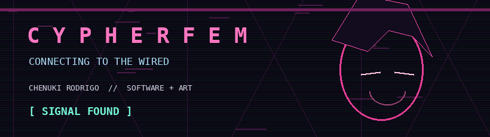
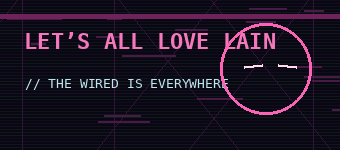
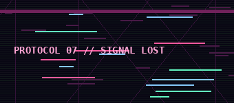
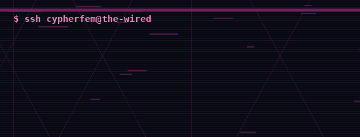

<div align="center">



### `// WELCOME TO THE WIRED //`

**CHENUKI RODRIGO**  ·  Software Engineering Co-op @ University of Guelph  
`creative coding` **/** `AI + ethical technology` **/** `web + UX`

[](https://drive.google.com/drive/folders/1g_YwLpNPLRVWQzI8q7qoo3Av18L9lvOb?usp=drive_link)
[](mailto:crodrigo@uoguelph.ca)




</div>

### `01 // identity.exe`

```yaml
name: Chenuki Rodrigo
location: Ontario, Canada
education: Bachelor of Computing — Software Engineering (Co-op)
area_of_emphasis: User Experience Design
interests: [creative coding, cyberfeminism, accessible UX, ethical AI]
currently: building at the intersection of art and technology
```

I build interactive software and expressive web experiences, with a particular interest in **women in technology**, **ethical AI**, and **digital storytelling**.

### `02 // featured_projects`

| Project | Technologies | About |
| :-- | :-- | :-- |
| **Prayer's Computer** | `Java` `JavaFX` `Groq API` | Interactive desktop story with AI-assisted gender-bias analysis and inclusive language suggestions. |
| **Hatsune Miku Website** | `HTML` `CSS` | Multi-page website with navigation, styling and a custom 404 page. |
| **Cyberfeminist Index** | `Wix` | Creative website exploring women, technology, and online culture. |
| **Daisy Chain Network** *(WIP)* | `Java` `Vaadin` | Women-in-STEM resource platform with organized views and navigation. |
| **Rental Car Management** | `C` `Make` `GitLab` | Linked-list operations, dynamic allocation, debugging and modular files. |

<div align="center">

</div>

### `03 // installed_modules`

**Programming:** `Java` `C` `Python (foundational)` `HTML` `CSS`  
**Frameworks:** `JavaFX` `Vaadin`  
**Web + design:** `Wix` `WordPress` `Canva` `UX / UI`  
**Developer tools:** `Git` `GitHub` `GitLab` `Linux` `Make` `Valgrind`  
**Concepts:** `REST APIs` `JSON` `Data Structures` `Debugging`

### `04 // system_log`

```console
[ OK ] designing user-focused applications
[ OK ] learning through experiments
[ OK ] researching ethical AI & bias
[ .. ] next project loading ...
```

<div align="center">


**`THE WIRED IS EVERYWHERE`**

<sub>Cyberpunk / Serial Experiments Lain–inspired original animated graphics.</sub>

</div>
